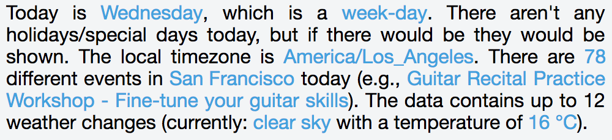
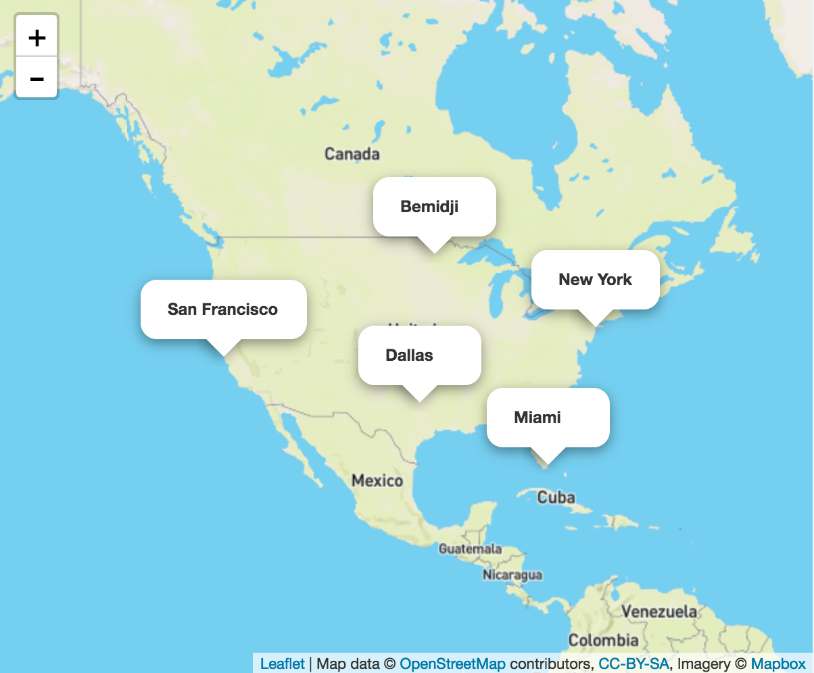
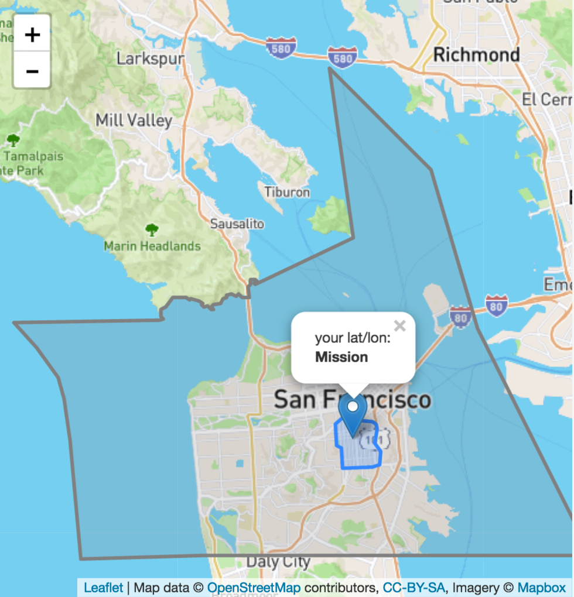

<p align="center">
  
</p>

# Breinify's API Library [](https://www.jsdelivr.com/package/npm/breinify-api)
[](https://badge.fury.io/bo/breinify-api)
[](https://badge.fury.io/js/breinify-api)
[](https://raw.githubusercontent.com/hyperium/hyper/master/LICENSE)
<sup>Features: **Temporal Data**, **(Reverse) Geocoding**, **Events**, **Weather**, **Holidays**, **Analytics**</sup>

This library utilizes [Breinify's API](https://www.breinify.com) to provide tasks like `geocoding`, `reverse geocoding`, `weather and events look up`, `holidays determination` through the API's endpoints, i.e., `/activity` and `/temporaldata`. Each endpoint provides different features, which are explained in the following paragraphs. In addition, this documentation gives detailed examples for each of the features available for the different endpoints.

**Activity Endpoint**: The endpoint is used to understand the usage-patterns and the behavior of a user using, e.g., an application, a mobile app, or a web-browser. The endpoint offers analytics and insights through Breinify's dashboard.

**TemporalData Endpoint**: The endpoint offers features to resolve temporal information like a timestamp, a location (latitude and longitude or free-text), or an IP-address, to temporal information (e.g., timezone, epoch, formatted dates, day-name),  holidays at the specified time and location, city, zip-code, neighborhood, country, or county of the location, events at the specified time and location (e.g., description, size, type), weather at the specified time and location (e.g., description, temperature).

## Running tests

The `test` task runs `test-setup` → `clean:combine` → `combine:false` → `test-run`. Specs load
the freshly combined core bundle from `target/combined` and plugins directly from `src/plugins`
in headless Chromium. Tests do not read or write `dist`. Use Node.js 20 or newer.

The `dist` task runs `test` first. Only after tests pass does it clean `dist`, minify the tested core
bundle, and copy/minify the plugins for distribution.
The project directory is the checkout containing **this README, `package.json`, and `gruntfile.js`**.
The test task prints the full path to its `gruntfile.js` whenever setup is missing.

### IntelliJ: setup and everyday use

No `npx` or globally installed Grunt is required.

1. Open this project's `gruntfile.js` in IntelliJ's Grunt tool window. Refresh its task list if
   `test` or `test-run` is not yet visible.
2. For a fresh checkout, install the dependencies in `package.json` using IntelliJ's configured
   Node interpreter and package manager.
3. Run **`test`**. It ensures the matching Chromium browser is installed, resolves browser library
   dependencies through `combine:false`, prepares the core test bundle, and runs the specs. The first browser download
   needs internet access and can take several minutes; later runs reuse it.

You can still run **`test-setup`** separately to prepare the browser. For a quick repeat against an
already prepared core bundle, use **`test-run`**. It skips rebuilding and setup, so core source edits
require another `test` run before they are covered; plugin source edits are loaded directly.
Use the same Node interpreter and environment throughout.

To run fewer tests, add `--spec=UiModifyContent` or `--spec=specs/Breinify-spec.js` to the Grunt run
configuration's arguments. This is a case-sensitive substring filter on spec file paths.

### Terminal use without npx

A missing-browser error prints a complete command with the **actual Node executable, local Grunt
CLI, and absolute gruntfile path**. Paste that command into a terminal: it works from any directory
and requires neither `node` nor `npx` on PATH. After setup succeeds, the output prints the equivalent
command to run the tests.

If Node is already on PATH, the shorter equivalents below work from the project directory:

```sh
node node_modules/grunt/bin/grunt test
node node_modules/grunt/bin/grunt test --spec=UiModifyContent
```

`npm test` is also available when npm is on PATH. These commands assume the dependencies in
`package.json` have been installed as described above.

### If the task fails

- **Test browser is not installed / Executable doesn't exist:** run `test-setup` in IntelliJ,
  wait for `Browser ready`, then rerun `test`. Alternatively, paste the complete terminal command
  printed in the error. No specs have run when this error appears.
- **Missing test input files:** run `test` instead of `test-run` to rebuild and prepare everything.
- **A build or dependency step fails:** fix the reported `combine`/`dep` error, then rerun `test`; the specs have not started.
- **A spec fails:** the output lists the failing spec and assertion. Detailed results, including
  stack traces, are in `target/test-results.json`. Fix the failure and rerun that file using `--spec`.
- **A file times out:** the default limit is 60 seconds. Add `--test-timeout=120000` to the Grunt
  arguments to allow 120 seconds per file for a deliberately longer suite.

Do not use `--force` to bypass failures; it does not fix setup or failing tests.
On Linux CI, install the browser's system dependencies by running the local Playwright CLI with
`install --with-deps --only-shell chromium` before running the tests.

### Test isolation and results

Each spec file gets a fresh browser context with isolated storage, cookies, and SDK instances.
Plugin specs receive the SDK's jQuery as a local `$` variable; it is not exposed on the page globally.
Non-fixture browser requests are blocked, so tests must mock calls to live services.

The task exits nonzero for failed specs, browser errors, timeouts, or an empty file selection.
Pending specs are counted separately. The `test` task regenerates the unminified core bundle under
`target/combined` through the existing build tasks; `test-run` reads it and the plugin source files
without changing them. Distribution minification and copying happen only after `dist` passes its test step.

## Split-test activity attribution

Build `activity.tags.splitTest` from the assignment used to render the experience:

```javascript
const assignment = response.splitTestData;
Breinify.UTL.user.applySplitTestTags(tags, assignment);

// Explicit values use the same assignment shape:
Breinify.UTL.user.applySplitTestTags(tags, {
    testName: 'My test',
    selectedInstance: assignedInstance,
    groupDecision: 'Original',
    isControlGroup: true
});
```

The helper updates `splitTest`, `group` and `groupType`, preserves other tags and returns the same
object. It never reads or updates stored assignments. Pass the captured assignment so delayed
clicks retain the instance that produced the experience. `isControlGroup` takes precedence over
legacy `isControl`; group names are not used to guess control status. Missing or invalid
assignments leave tags untouched, so callers do not need a plain-object guard. Inactive assignments
use `group: null` and `groupType: 'none'`. An optional third argument supplies plugin defaults:
`defaultGroup`, `defaultControlGroup`, `defaultTestGroup`, `defaultGroupType`, `controlGroupType`
and `testGroupType`. Providing a defaults object (including `{}`) also applies defaults when the
assignment is missing or invalid.

Use `createSplitTestActivityTag(assignment)` only when the formatted label alone is needed.
It returns `testName (selectedInstance)`, or `null` without a test name. Missing instances retain
the bare name for compatibility, but the backend's instance attribution requires a complete
assignment; an incomplete label can exclude otherwise valid clicks from metrics.

Recommendations, content modifications and countdowns share this helper. Publish the updated
core library before or together with plugins and customer scripts that call it.

## Getting Started

For feature-based experiences, see [Feature resolution and UI configuration](../../brein-external/brein-external-script-creator/docs/feature-definitions.md#waiting-for-freshness-when-using-a-feature)
for waiting on current-page observations while retaining persisted values.

### Retrieving an API-Key

First of all, you need a valid API-key, which you can get for free at [https://www.breinify.com](https://www.breinify.com). In the examples, we assume you have the following api-key:

**938D-3120-64DD-413F-BB55-6573-90CE-473A**

### Including the Library

The library can be added as script, using:

```html
<script type="text/javascript" src="https://cdn.jsdelivr.net/npm/breinify-api@1.0.15/dist/breinify-api.min.js"></script>
```

If you want to use the most current **snapshot** version (only recommended for development purposes), you can also use:

```html
<script type="text/javascript" src="https://rawgit.com/Breinify/brein-api-library-javascript-browser/master/dist/breinify-api.min.js"></script>
```

If you prefer to use **bower** the newest version can be installed using:

```bash
bower install breinify-api --save
```

## Activity: Selected Usage Examples

The endpoint is used to track the usage of, e.g., an application, an app, or a web-site. There are several libraries available to be used for different system (e.g., [iOS](https://github.com/Breinify/brein-api-library-ios), [Android](https://github.com/Breinify/brein-api-library-android), [Java](https://github.com/Breinify/brein-api-library-java), [nodeJs](https://github.com/Breinify/brein-api-library-node), [ruby](https://github.com/Breinify/brein-api-library-ruby), [php](https://github.com/Breinify/brein-api-library-php), [python](https://github.com/Breinify/brein-api-library-python)).

### Track jsFiddle Usage

The [jsFiddle (ojkvwwd9)](https://jsfiddle.net/breinify/ojkvwwd9/) shows how to use the endpoint to track the usage of this specific fiddle. There are plenty more use-cases in which the tracking of activities can be useful to understand and enhance a service. There are also several more possibilities on how to add identification, descriptions, categories, or tags. Have a look at the [additional documentation](#further-links).

## TemporalData: Selected Usage Examples

### Retrieve Client's Information (Location, Weather, Events, Timezone, Time)

The endpoint is capable to retrieve some information about the client, based on client specific information (e.g., the IP-address). The first example uses this information to retrieve some information, like the weather, events, or the timezone.

<p align="center">
  <br/>
  <sup>This is a screenshot of the jsFiddle (3wz4u5d1) created on the 29/03/2017 at 8:54 p.m.</sup>
</p>

The whole information is retrieved using the following simple JavaScript (see also [jsFiddle (3wz4u5d1)](https://jsfiddle.net/breinify/3wz4u5d1/)):

```javascript
Breinify.setConfig({ 'apiKey': '938D-3120-64DD-413F-BB55-6573-90CE-473A' });
Breinify.temporalData(function(data) {
	document.getElementById('result').innerHTML = createText(data);
});
```

### Geocoding (resolve Free-Text to Locations)

The library enables you to use the geocoding feature of the `temporalData` endpoint by passing a free-text and resolving it
to an associated location.

```javascript
var loc = {
  text: 'NYC'
};

Breinify.temporalData({ additional: { location: loc }}, false, function(data) {
    // use the returned data
});
````

The endpoint will return the specific information to the defined location (i.e., the city, the state, and coordinates as 
latitude/longitude pair). A more advanced example can be found at the [jsFiddle (egyhn5fz)](https://jsfiddle.net/breinify/egyhn5fz/).

<p align="center">
  <br/>
  <sup>Screenshot of the sFiddle (egyhn5fz) resolving the texts: `NYC`, `San Francisco`, `Dallas`, `Miami`, `Bemidji`</sup>
</p>


### Reverse Geocoding (retrieve GeoJsons for, e.g., Cities, Neighborhoods, or Zip-Codes)

The `temporalData` endpoint enables you to perform reverse geocoding. To do so, simple pass in the known latitude and longitude
into the request.

```javascript
var loc = {
  latitude: 37.7609295,
  longitude: -122.4194155
};

Breinify.temporalData({ additional: { location: loc }}, false, function(data) {
    // use the returned data
});
````

If you like to get further information or even visualize the country, county, city, or neighborhood the location is in, it
is possible to ask for appropriate geoJson instances and utilize them directly in, e.g., [leafLet](http://www.leafletjs.com).

```javascript
var loc = {
  latitude: latLon[0],
  longitude: latLon[1],
  shapeTypes: ['CITY', 'NEIGHBORHOOD']
};

Breinify.temporalData({ additional: { location: loc }}, false, function(data) {
    // use the returned data
});
````

Have a look at [jsFiddle (qq4ryw6y)](https://jsfiddle.net/breinify/qq4ryw6y/) for a complete example.

<p align="center">
  <br/>
  <sup>This is a screenshot of the jsFiddle (qq4ryw6y), utilizing leafLet to visualize the resolved geoJsons</sup>
</p>

## Limitations

The open `/temporalData` endpoint is limited to US specific locations only. Furthermore, weather specific data is only available for the years 2016 and later.

## Further links

To understand all the capabilities of Breinify's API, you can find further information:
- the [library documentation](documentation/api.md),
- the [full API documentation](https://www.breinify.com/documentation/index.html),
- [Breinify's Website](https://www.breinify.com).
